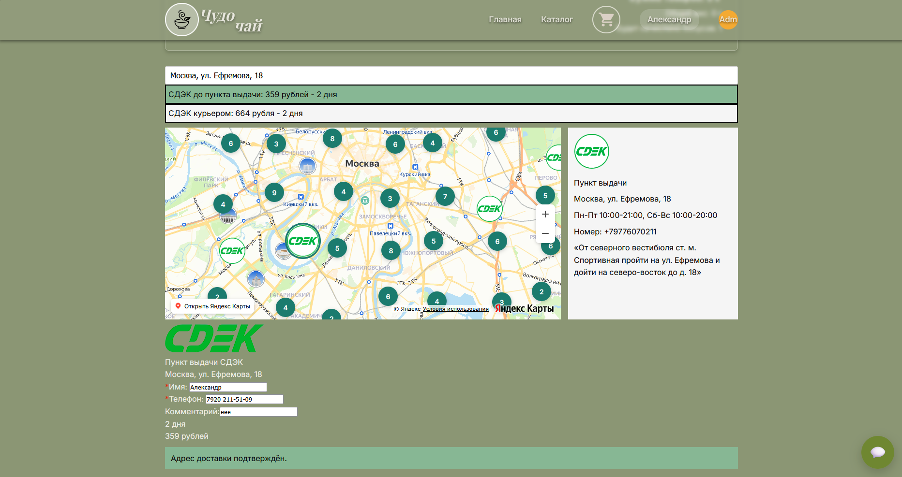

# Как подключить EShopLogistic к своему сайту

Компонент показывает покупателю карту и способы доставки, считает стоимость через EShopLogistic и собирает контакты получателя. Заказ на доставку создаётся на вашем сервере функцией `createEShopDeliveryOrder`.

## 1. Что понадобится

- Проект на **React 17+** (Vite, Create React App, Next.js и т.п.) с новым JSX-трансформом: импортировать `React` в файл не нужно.
- Сервер на **Node.js 18+**, где глобально доступен `fetch` (Express, Next.js API routes и т.п.).
- Три ключа:

| Ключ | Где получить | Для чего |
| --- | --- | --- |
| `DADATA_TOKEN` | Личный кабинет [dadata.ru](https://dadata.ru/profile/#info) → «API-ключ» | Подсказки адресов и определение города по IP |
| `ESHOPLOGISTIC_TOKEN` | Личный кабинет [EShopLogistic](https://eshoplogistic.ru) → настройки API | Расчёт доставки и создание заказа |
| `YANDEX_API_KEY` | [Кабинет разработчика Яндекса](https://developer.tech.yandex.ru/) → «JavaScript API и HTTP Геокодер» | Карта и определение адреса по клику |

> Ключи DaData и Яндекса будут видны в браузере — это нормально для этих сервисов. В настройках ключа Яндекса укажите домен своего сайта (и `localhost` для разработки), чтобы ключом не воспользовались чужие сайты.

## 2. Установка

1. Установите зависимость:

   ```bash
   npm install react-dadata
   ```

2. Скопируйте из репозитория в свой проект, например в `src/components/`:
   - `EShopLogistic.jsx`
   - `EShopLogistic.css`

   Файлы должны лежать в одной папке: компонент сам импортирует `./EShopLogistic.css`.

3. Скопируйте на сервер `createEShopDeliveryOrder.js`, например в `utils/`.

## 3. Ключи в переменных окружения

Не храните ключи в коде. Пример для Vite (`.env.local`):

```bash
VITE_DADATA_TOKEN=ваш-dadata-token
VITE_ESHOPLOGISTIC_TOKEN=ваш-eshop-токен
VITE_YANDEX_API_KEY=ваш-yandex-api-key
```

На сервере (`.env`):

```bash
ESHOPLOGISTIC_TOKEN=ваш-eshop-токен
```

Для Next.js используйте префикс `NEXT_PUBLIC_` вместо `VITE_` и `process.env` вместо `import.meta.env`.

## 4. Вставьте компонент на страницу оформления заказа

```jsx
import { useState } from "react";
import { EShopLogistic } from "./components/EShopLogistic";

export function CheckoutDelivery({ cartWeightKg }) {
  // null — доставка ещё не выбрана или контакты не заполнены.
  const [deliveryData, setDeliveryData] = useState(null);

  const placeOrder = async () => {
    const response = await fetch("/api/order", {
      method: "POST",
      headers: { "Content-Type": "application/json" },
      body: JSON.stringify({ deliveryData }),
    });

    if (!response.ok) {
      alert("Не удалось оформить доставку, попробуйте ещё раз.");
    }
  };

  return (
    <>
      <EShopLogistic
        DADATA_TOKEN={import.meta.env.VITE_DADATA_TOKEN}
        ESHOPLOGISTIC_TOKEN={import.meta.env.VITE_ESHOPLOGISTIC_TOKEN}
        YANDEX_API_KEY={import.meta.env.VITE_YANDEX_API_KEY}
        orderWeight={cartWeightKg}
        onDeliveryConfirm={setDeliveryData}
      />

      <button disabled={!deliveryData} onClick={placeOrder}>
        Оформить доставку
      </button>
    </>
  );
}
```

Важно:
- `onDeliveryConfirm` вызывается каждый раз, когда данные доставки меняются. Пока покупатель не выбрал способ и пункт или адрес и не заполнил обязательные поля, придёт `null`. Поэтому кнопка заказа выключена, пока `deliveryData` пустой.
- `orderWeight` — вес корзины в килограммах. При его изменении стоимость пересчитается автоматически.
- **Next.js (App Router):** добавьте `"use client";` первой строкой в файл, где используется компонент.

## 5. Создайте заказ на сервере

Пример для Express:

```js
const express = require("express");
const { createEShopDeliveryOrder } = require("./utils/createEShopDeliveryOrder");

const app = express();
app.use(express.json());

app.post("/api/order", async (req, res) => {
  const { deliveryData } = req.body;

  try {
    const deliveryId = await createEShopDeliveryOrder(
      process.env.ESHOPLOGISTIC_TOKEN,
      deliveryData,
      orderData,   // данные заказа — см. раздел «Использование Backend» ниже
      companyData  // данные отправителя — см. раздел «Использование Backend» ниже
    );

    res.status(200).send({ deliveryId });
  } catch (error) {
    console.error(error);
    res.status(400).send({ error: error.message });
  }
});
```

- Функция бросает исключение, если данные доставки неполные или EShopLogistic вернул ошибку, поэтому оборачивайте вызов в `try/catch`.
- Если проект на ES-модулях (`"type": "module"` в `package.json`), замените в конце файла `module.exports = { createEShopDeliveryOrder };` на `export { createEShopDeliveryOrder };` и подключайте через `import`.
- Стоимость доставки (`deliveryData.price`) приходит из браузера. Если вы берёте её с покупателя, перепроверьте сумму на сервере.

## 6. Проверьте, что всё работает

1. Откройте страницу оформления: должен определиться город и появиться список способов доставки.
2. Выберите доставку до пункта выдачи → кликните по точке на карте → появится форма контактов.
3. Заполните имя и телефон → в `onDeliveryConfirm` придёт объект доставки, кнопка заказа станет активной.
4. Переключитесь на курьера → кликните по карте или введите адрес с номером дома → проверьте, что стоимость пересчиталась.

## Частые проблемы

| Симптом | Причина и решение |
| --- | --- |
| «Не удалось загрузить службы доставки» | Неверный `ESHOPLOGISTIC_TOKEN` или у ключа не подключены службы доставки. |
| Карта не появляется | Неверный `YANDEX_API_KEY` или домен сайта не добавлен в ограничения ключа. |
| Не работают подсказки адресов | Неверный `DADATA_TOKEN` или исчерпан дневной лимит DaData. |
| Город не определился автоматически | Это не ошибка: покупатель может выбрать город в строке поиска. |

# Контакты

В случае проблем с компонентом писать сюда:
https://t.me/HoneyLime1


# Использование Frontend

```jsx
import { EShopLogistic } from "../components/EShopLogistic";

export function DeliveryBlock() {
  const [deliveryData, setDeliveryData] = useState(null);

  // Оформление заказа
  const handlePlaceOrder = async () => {
    try {
      await fetch("/api/test", {
        method: "POST",
        headers: {
          "Content-Type": "application/json"
        },
        body: JSON.stringify({
          deliveryData
        }),
      });
    } catch (error) {
      console.error("Ошибка оформления доставки:", error);
    }
  };

  return (
    <>
      <EShopLogistic
        DADATA_TOKEN="ваш-dadata-token"
        ESHOPLOGISTIC_TOKEN="ваш-eshop-токен"
        YANDEX_API_KEY="ваш-yandex-api-key"
        orderWeight={1.2}
        onDeliveryConfirm={(deliveryData) => {
          setDeliveryData(deliveryData);
        }}
      />
      
      <button
        className="btn-pay"
        onClick={() => {
          handlePlaceOrder();
        }}
      >
        Оформить доставку
      </button>
    </>
  );
}
```


# Использование Backend

```js
const { createEShopDeliveryOrder } = require("./utils/createEShopDeliveryOrder");

const ESHOPLOGISTIC_TOKEN = "ваш-eshop-токен";

app.post('/api/test', async(req, res) => {
  const { id, deliveryData } = req.body;

  let companyData = {
    senderName: "ваше имя",              // string 	Имя
    senderPhone: "ваш номер",            // string 	Телефон
    senderCompany: "ваша компания",      // string 	Название компании
    
    pick_up: false, // boolean 	Забор груза от отправителя
    address: {      // заполняем если pick_up = true
      region: "",   // string 	Регион. Например: Московская область
      city: "",     // string 	Населённый пункт
      street: "",   // string 	Улица
      house: "",    // string 	Номер строения
      room: ""      // string 	Квартира / офис / помещение
    }
  };

  let orderData = {
    id: id,                     // string 	Идентификатор заказа на сайте.  
    type: 1,                    // integer 	Тип заказа. Доступно 2 варианта: «1» - Интернет-магазин, «2» - Доставка.
    combine_places_apply: true, // boolean 	
                                // Объединить все грузовые места в одно.
                                // При этом внутри грузового места формируется список позиций для страховки.
                                // По умолчанию = false.
    total_weight: 0,            // double 	Вес, в кг.
    dimensions: "15*25*10",             // string 	Габариты. Формат: строка вида «Д*Ш*В», в сантиметрах. Например: 15*25*10 .
    payment: "already_paid",    // string 	Способ оплаты
                                // Возможные варианты:
                                // already_paid - заказ уже оплачен,
                                // cash_on_receipt - наличными при получении,
                                // card_on_receipt - картой при получении,
                                // cashless - безналичный расчет
    places: [{            // array Нужно заполнить информацией о заказах 
        article: "",      // string 	Идентификатор товара / груза.
        name: "",         // string 	Название
        count: 1,         // integer 	Количество
        price: 100.5,     // double 	Цена, включая НДС
        weight: 0.15,     // double 	Вес, в кг.
        dimensions: "",   // string 	Габариты. Формат: строка вида «Д*Ш*В», в сантиметрах. Например: 15*25*10 .
        vat_rate: -1,     // integer 	Значение ставки НДС 
                          // Возможные варианты: 0, 5, 7, 10, 20, -1 (без НДС)
      }],
  };

  const deliveryId = await createEShopDeliveryOrder(ESHOPLOGISTIC_TOKEN, deliveryData, orderData, companyData);

  res.status(200).send({deliveryId: deliveryId});
});
```

# Пример реализации
[https://чудочай.рф/checkout](https://чудочай.рф/checkout)



### Props

| Prop | Тип | Обязательный | Описание |
| --- | --- | --- | --- |
| `DADATA_TOKEN` | `string` | Да | Токен DaData для подсказок адресов. |
| `ESHOPLOGISTIC_TOKEN` | `string` | Да | Токен EShopLogistic для расчёта доставки в браузере. Не передавайте сюда секретный серверный токен, если он не предназначен для публичного клиента. |
| `YANDEX_API_KEY` | `string` | Да | Ключ API Яндекс.Карт/геокодера. |
| `orderWeight` | `number` | Да | Вес заказа в килограммах для расчёта доставки. |
| `onDeliveryConfirm` | `(deliveryData) => void` | Да | Вызывается при каждом изменении итоговых данных: объект доставки, когда выбраны способ, точка и заполнены контакты (его нужно передать в `createEShopDeliveryOrder`), или `null`, когда данные стали неполными. |


## Серверная функция `createEShopDeliveryOrder`

`createEShopDeliveryOrder` создаёт заказ доставки через API EShopLogistic. Эту функцию нужно вызывать на сервере, а не в браузере, потому что она использует токен создания заказа.


### Сигнатура

```js
createEShopDeliveryOrder(ESHOPLOGISTIC_TOKEN, deliveryData, orderData, companyData)
```

| Параметр | Тип | Описание |
| --- | --- | --- |
| `ESHOPLOGISTIC_TOKEN` | `string` | Токен EShopLogistic для создания заказа. Передавайте его только на сервере. |
| `deliveryData` | `object` | Данные выбранной доставки: служба, тип доставки, адрес/терминал, цена, получатель, комментарий. |
| `orderData` | `object` | Данные заказа: id, товары/грузовые места, вес, габариты, оплата. |
| `companyData` | `object` | Данные магазина/отправителя и адреса отправки. |